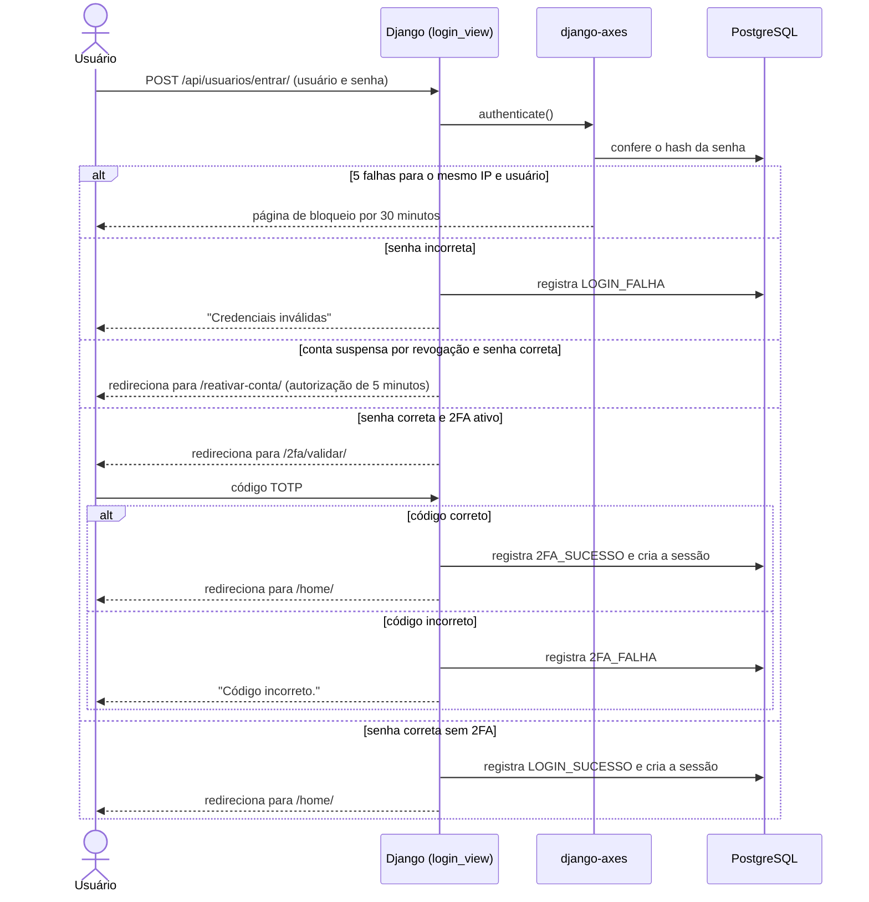
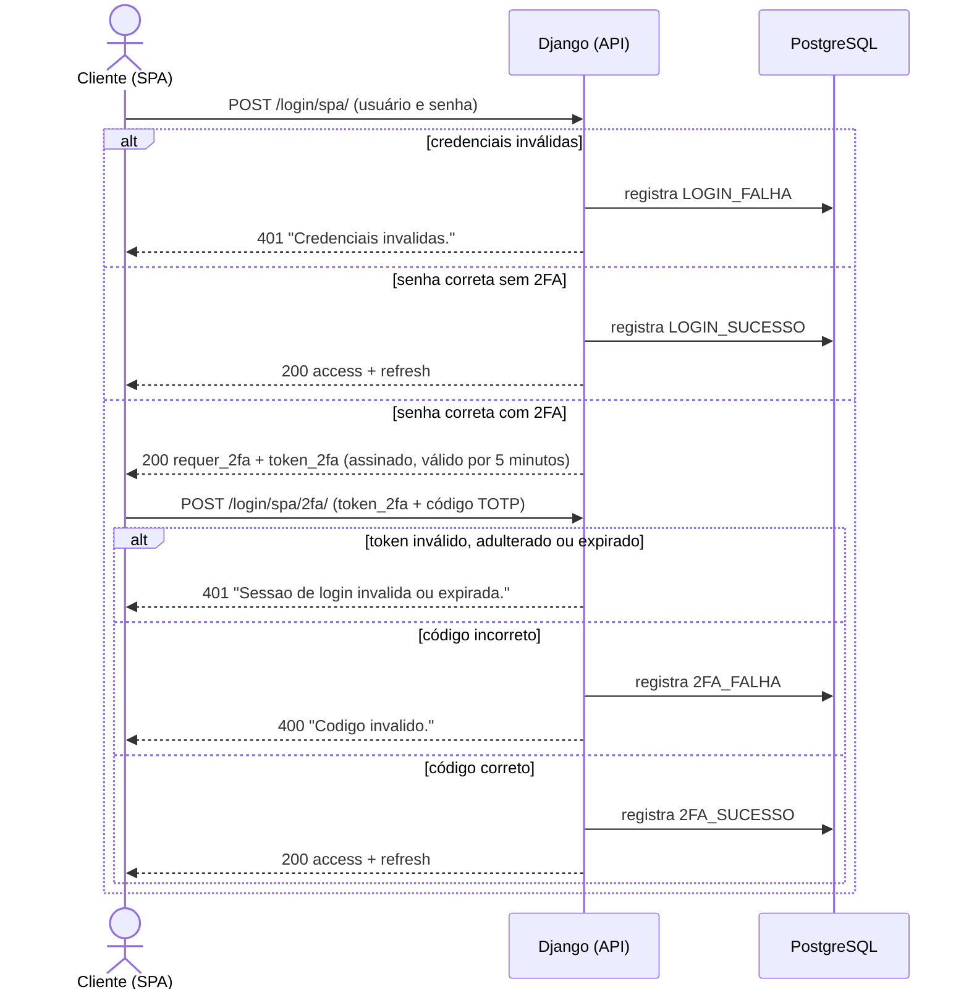
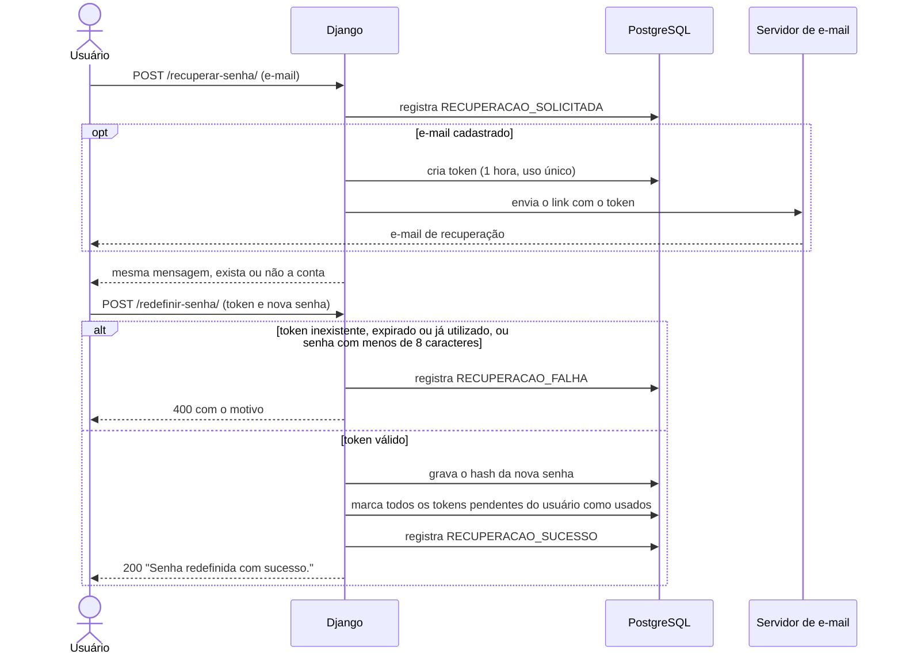
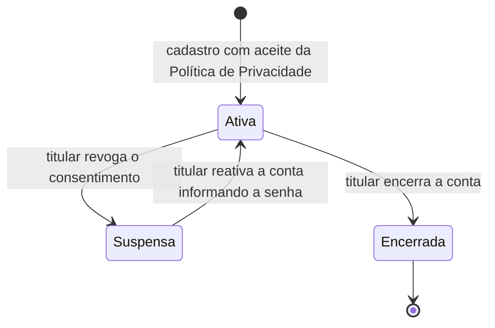

# Fluxos de autenticação e dados documentados

Este documento apresenta, em forma de diagramas de sequência, os fluxos de autenticação, recuperação de senha e o ciclo de vida dos dados pessoais no EmprestaCampus. A descrição detalhada de cada etapa está em `Autenticacao.md`, `RecSenha.md` e na Política de Privacidade.

Em todos os fluxos, o cliente se comunica com o Nginx por HTTPS, e o Nginx encaminha a requisição ao Django pela rede interna do Docker, informando o IP real do cliente no cabeçalho `X-Real-IP`. Todos os eventos marcados como "registra" são gravados na auditoria (`RegistroAuditoria`).

## Login web por sessão (`/api/usuarios/entrar/`)

**Fluxo:** usuário/senha → `authenticate()` (com limite de tentativas do `django-axes`) → se o usuário tem 2FA confirmado, redireciona para validação TOTP → só então `login()` de sessão é efetivado. Se a conta estiver suspensa por revogação do consentimento e a senha estiver correta, o usuário é levado à tela de reativação.

Usado pela interface HTML (Django Templates).

A sessão expira após 30 minutos de inatividade. O encerramento (`/api/usuarios/sair/`) só aceita `POST` com token CSRF.

## Login via API/JWT, fluxo em duas etapas com 2FA (`/api/usuarios/login/spa/` + `/api/usuarios/login/spa/2fa/`)

A primeira etapa valida usuário/senha. Se houver 2FA confirmado, retorna um token intermediário assinado (`django.core.signing`, com expiração de 300 segundos), sem emitir JWT ainda.

A segunda etapa exige esse token + o código TOTP válido para, só então, emitir o par de tokens JWT (`access/refresh`).

O usuário nunca é identificado por ID exposto ao cliente — apenas pelo token assinado, o que impede um atacante de pular a etapa de senha enviando um ID de usuário diretamente.

O token de acesso vale 1 hora. Com o `refresh` (válido por 7 dias), o cliente obtém um novo token de acesso em `/api/usuarios/login/renovar/`, sem reenviar a senha.

## Login via API/JWT sem 2FA (rota legada)

**Path:** `path("login/", TokenObtainPairView.as_view())`, do `djangorestframework-simplejwt`.

Essa rota foi identificada, durante a revisão técnica do projeto, como uma inconsistência de segurança: permitia obter um JWT válido sem passar pelo segundo fator, mesmo para usuários com 2FA ativado.

Após confirmação de que nenhuma view, teste automatizado ou template do projeto dependia dela, a rota foi removida, eliminando esse caminho alternativo que contornava o 2FA. Hoje, o único caminho para obter um JWT é o fluxo em duas etapas descrito acima.

## Fluxo de recuperação de senha

**Solicitação de e-mail** → geração de token criptograficamente seguro (`secrets.token_urlsafe(32)`) com validade de 1 hora e uso único → envio do link por e-mail (SMTP, ou console do servidor quando o envio de e-mail não está configurado) → validação do token → redefinição de senha → token utilizado e demais tokens pendentes do usuário marcados como usados.

## Ciclo de vida dos dados pessoais

O diagrama abaixo mostra os estados da conta do titular e as ações que levam de um estado a outro.

| Etapa | O que acontece com os dados | Onde no sistema |
| --- | --- | --- |
| **Coleta** | No cadastro: nome, sobrenome, nome de usuário, e-mail, matrícula, telefone, vínculo, senha e o aceite da política (data e versão). Durante o uso: histórico de empréstimos, logs de auditoria com IP, segredo TOTP (se o 2FA for ativado) e o cookie de fuso horário. | Tela `cadastrar/`, `RegistroSerializer` |
| **Armazenamento** | Banco PostgreSQL, acessível apenas pela rede interna do Docker. A senha é guardada como hash PBKDF2-SHA256 e o telefone é cifrado com Fernet. Os logs de auditoria são imutáveis. | `usuarios/models.py`, `usuarios/crypto.py`, `auditoria/` |
| **Uso** | Autenticação, gestão dos empréstimos, notificações por e-mail e auditoria de segurança. | Módulos `usuarios`, `emprestimos`, `notificacoes`, `auditoria` |
| **Consulta e portabilidade** | O titular consulta seus dados em "Meu Perfil" e baixa um arquivo JSON com os dados cadastrais, o registro do consentimento e o histórico de empréstimos. | `perfil/`, `perfil/exportar/` |
| **Revogação** | A conta é suspensa e o acesso é bloqueado. Os dados permanecem armazenados para permitir a reativação, que exige a senha do titular. | `perfil/revogar-consentimento/`, `reativar-conta/` |
| **Eliminação** | O encerramento substitui nome, nome de usuário, e-mail, matrícula e telefone por valores anônimos, apaga o segredo TOTP e os tokens de recuperação e torna a senha inutilizável. Permanecem apenas o histórico de empréstimos e os logs de auditoria, vinculados à conta anonimizada, para controle patrimonial e segurança. | `perfil/encerrar-conta/` |

O atendimento aos direitos do titular, os prazos e o canal de contato estão descritos na Política de Privacidade.